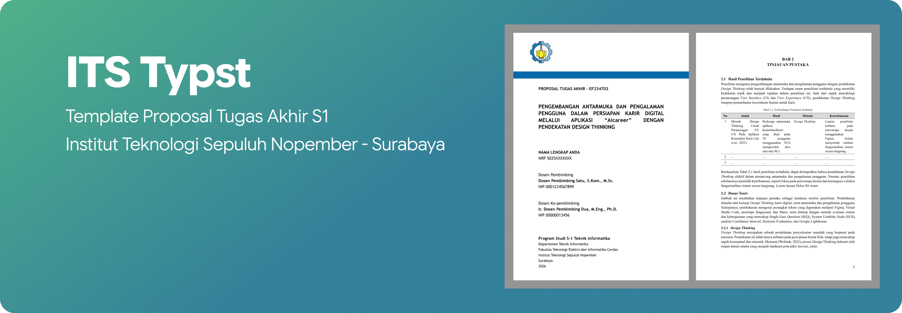

<div align="center">
  <h1>Template Proposal Tugas Akhir</h1>

  <p>
    
    
    
    
    
  </p>

  <p>Template <a href="https://typst.app">Typst</a> untuk penulisan Proposal Tugas Akhir S-1 Institut Teknologi Sepuluh Nopember (ITS).</p>
</div>

## Prasyarat

- **Typst** ≥ 0.13 - [typst.app/docs](https://typst.app/docs) atau instal via:
  ```bash
  # Windows
  winget install --id Typst.Typst

  # macOS / Linux
  brew install typst
  ```
- **VSCode** (opsional) - instal ekstensi [Tinymist Typst](https://marketplace.visualstudio.com/items?itemName=myriad-dreamin.tinymist) untuk preview real-time.

## Struktur Proyek

```
.
├── main.typ                    # Entry point
├── data.yaml                   # Isi data kamu di sini
├── daftar-pustaka.bib          # Referensi BibTeX
├── template/                   # Engine template
│   ├── template.typ
│   ├── lib.typ
│   └── ...
├── content/
│   ├── 03-abstrak.typ          # Tulis abstrak
│   ├── chapters/
│   │   ├── 01-bab1.typ         # BAB 1: Pendahuluan
│   │   ├── 02-bab2.typ         # BAB 2: Tinjauan Pustaka
│   │   └── 03-bab3.typ         # BAB 3: Metodologi
│   └── ...
└── assets/
    └── figures/                # Taruh gambar di sini
```

## Cara Pakai

### 1. Isi Metadata (`data.yaml`)

Edit `data.yaml` dengan data proposal kamu:

```yaml
kode-mk: "EF234702"

judul:
  id: "Judul dalam Bahasa Indonesia"
  en: "Title in English"

mahasiswa:
  nama: "Nama Lengkap"
  nrp: "5025XXXXXXX"

pembimbing:
  nama: "Nama Dosen, Gelar"
  nip: "XXXXXXXXXXXXXXXXXX"

ko-pembimbing:
  - nama: "Nama Ko-pembimbing, Gelar"
    nip: "XXXXXXXXXXXXXXXXXX"

penguji:
  - nama: "Nama Penguji Pertama, Gelar"
    label:
      id: "Penguji"
      en: "Examiner 1"
  - nama: "Nama Penguji Kedua, Gelar"
    label:
      id: "Penguji"
      en: "Examiner 2"

institusi:
  prodi:
    id: "Program Studi S-1 Teknik Informatika"
    en: "Undergraduate Study Program of Informatics"
  departemen:
    id: "Departemen Teknik Informatika"
    en: "Department of Informatics"
  fakultas:
    id: "Fakultas Teknologi Elektro dan Informatika Cerdas"
    en: "Faculty of Intelligent Electrical and Informatics Technology"
  nama: "Institut Teknologi Sepuluh Nopember"
  kota: "Surabaya"

tahun: "2026"
bulan:
  id: "Januari"
  en: "January"
tanggal: "1"
```

> Field `ko-pembimbing` boleh array kosong `[]` jika tidak ada.

### 2. Tulis Konten

| Yang diubah | File |
|---|---|
| Abstrak (ID + EN) | `content/03-abstrak.typ` |
| BAB 1 – BAB 3 | `content/chapters/01-bab1.typ` s.d. `03-bab3.typ` |
| Daftar Pustaka | `daftar-pustaka.bib` (format BibTeX) |
| Lampiran | `content/12-lampiran.typ` |
| Gambar | `assets/figures/` |

### 3. Compile

```bash
# Compile sekali → main.pdf
typst compile main.typ

# Compile dengan nama file output kustom
typst compile main.typ NamaLengkap-NRP-ProposalTA.pdf

# Watch mode — auto-compile setiap kali file disimpan (tanpa VSCode)
typst watch main.typ
```

> Jika menggunakan VSCode + ekstensi Tinymist, preview sudah real-time otomatis tanpa perlu menjalankan `watch` secara manual. `watch` berguna jika bekerja di luar VSCode (terminal, editor lain, dsb).

## Helper Functions

Template menyediakan beberapa fungsi pembantu yang sudah di-import otomatis di setiap bab:

| Fungsi | Kegunaan |
|---|---|
| `#gambar(...)` | Sisipkan gambar dengan caption dan label otomatis |
| `#kode-sumber(...)` | Blok kode sumber dengan syntax highlight |
| `#kode-semu(...)` | Blok pseudocode / algoritma |
| `#timeline-table(...)` | Tabel jadwal kegiatan (Gantt-style) |
| `#allow-table-break[...]` | Tabel panjang yang bisa terpotong antar halaman |

Untuk contoh penggunaan lengkap, lihat langsung implementasinya di `content/chapters/`.

## Sistematika Dokumen

| Bagian | Penomoran |
|---|---|
| Halaman Judul | — |
| Lembar Pengesahan, Abstrak, Daftar-daftar | Romawi kecil (i, ii, iii…) |
| BAB 1 – BAB 3, Daftar Pustaka, Lampiran | Arab (1, 2, 3…) |

Seluruh bagian bilingual (Indonesia + Inggris) diatur otomatis oleh template.

## Kontributor

[](https://github.com/ITS-Typst/template-proposal-TA/graphs/contributors)

## Lisensi

Dirilis di bawah lisensi **MIT** - lihat [LICENSE](LICENSE) untuk teks lengkapnya. Bebas digunakan, dikembangkan, dan disesuaikan dengan kebutuhan.
